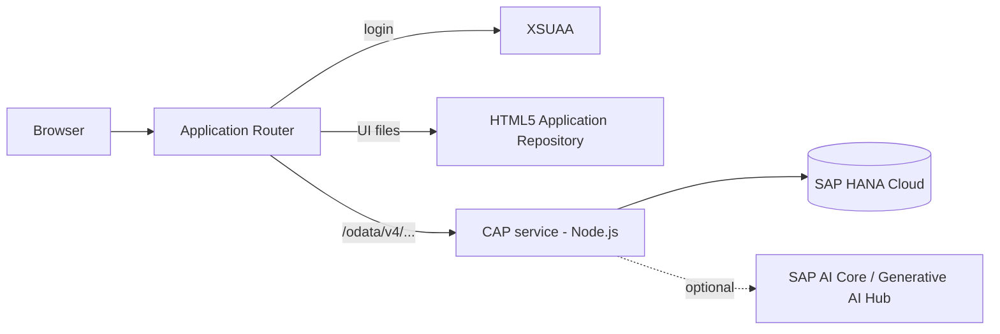
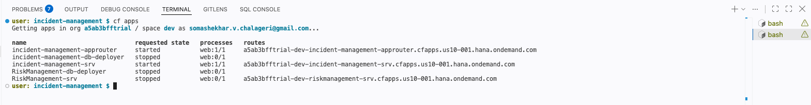

# Incident Management: SAP CAP on SAP BTP

A support-incident application built with the **SAP Cloud Application Programming Model (CAP, Node.js)**, a **SAP Fiori elements** UI and deployment to **SAP BTP Cloud Foundry** (SAP HANA Cloud, XSUAA, HTML5 Application Repository, Application Router).

The project started from the SAP CAP incident-management learning path and was extended with business logic, a pluggable classification service, role-based access, automated tests and a documented BTP deployment. See [What I added](#what-i-added) for the differences.

> **Demo:** screenshots are in [`docs/screenshots`](docs/screenshots). A short screen recording is available at **[demo video link]** [`docs/screenshots`](docs/screenshots/Index.mov). The live deployment runs on a BTP trial account and sits behind SAP login, so it is shown on request.

## Features

- Create and manage support incidents with draft handling (create, edit, activate, discard)
- Customers, addresses and a conversation thread per incident
- Automatic urgency and category classification when an incident is created
- Closed incidents are protected against modification (custom validation)
- Two roles: `support` (processes incidents) and `admin` (manages customers and incidents)
- Fiori elements list report and object page with value helps, status criticality and filters

## What I added

| Area | Extension |
|---|---|
| Classification | Pluggable classifier (`srv/ai/classifier.js`) with a rule-based default and an LLM provider (SAP AI Core / Generative AI Hub) behind a switch |
| Safety | LLM output is whitelisted, only title and message leave the service, 8 s timeout, automatic fallback to rules |
| Business logic | Urgency detection on creation, validation that blocks changes to closed incidents |
| Security | Role model (`support`, `admin`) enforced through XSUAA scopes and `@requires` |
| Quality | Jest tests with `cds.test` for the OData endpoints, the draft flow and the classifier |
| Deployment | MTA for Cloud Foundry: HANA Cloud (HDI), XSUAA, HTML5 repo, standalone Application Router |

## Architecture



## Tech stack

| Layer | Technology |
|---|---|
| Backend | SAP CAP (`@sap/cds` 9), Node.js, CDS, OData V4 |
| UI | SAP Fiori elements (list report and object page), SAPUI5 |
| Database | SQLite (local), SAP HANA Cloud (BTP) |
| Auth | Mocked users (local), XSUAA (BTP) |
| Tests | Jest, `@cap-js/cds-test` |
| Deployment | MTA (`mbt`), Cloud Foundry CLI |

## Getting started (local)

Prerequisites: Node.js LTS and the CDS development kit (`npm i -g @sap/cds-dk`).

```bash
npm install
npm run watch-incidents      # or: cds watch
```

The app runs at `http://localhost:4004`. Local development uses mocked authentication:

| User | Roles |
|---|---|
| `alice` | `support` |
| `bob` | `support` |

Mocked users have an empty password. The `AdminService` requires the `admin` role, so add an admin user under `cds.requires.[development].auth.users` in `package.json` to use it locally.

## Data model

```
Incidents  --> Customers --> Addresses
    |--> Status / Urgency (code lists)
    '--> conversation (composition: messages per incident)
```

Defined in [`db/schema.cds`](db/schema.cds). Services are in [`srv/service.cds`](srv/service.cds), custom logic in [`srv/service.js`](srv/service.js).

## Incident classification

New incidents are classified (urgency and category) in [`srv/ai/classifier.js`](srv/ai/classifier.js).

| `AI_PROVIDER` | Behaviour |
|---|---|
| `rules` (default) | Keyword rules, no external service needed |
| `orchestration` | LLM through SAP AI Core / Generative AI Hub (SAP Cloud SDK for AI) |

Design decisions:

- LLM output is **whitelisted** (`normalize()`) and never trusted directly
- Only the incident title and message are sent to the model, **no customer personal data**
- 8 s timeout and automatic **fallback to the rules** if the model call fails
- Unit-tested without any external service (`tests/classifier.test.js`)

> **Status:** the LLM path is implemented but **not verified end to end**, because it needs an SAP AI Core instance (Extended plan). The rule-based path is what runs by default, locally and on BTP.

## Tests

```bash
npm test
```

The tests cover the OData endpoints, the full draft lifecycle (create, activate, edit, close), the rule that closed incidents cannot be modified, and the classifier (including rejection of invalid model output).

## Deployment to SAP BTP (Cloud Foundry)

Prerequisites:

- A BTP subaccount with Cloud Foundry enabled and a space
- A running **SAP HANA Cloud** instance mapped to the space (trial instances stop automatically and must be restarted)
- CLI tools: `cf` with the `multiapps` plugin, and `mbt`

```bash
cf login -a <api-endpoint>
mbt build -t gen --mtar mta.tar
cf deploy gen/mta.tar
```

What gets deployed (see [`mta.yaml`](mta.yaml)):

| Module / resource | Purpose |
|---|---|
| `incident-management-srv` | CAP backend (Node.js) |
| `incident-management-db-deployer` | Creates tables and views in HANA (HDI container) |
| `incident-management-app-deployer` | Uploads the Fiori app to the HTML5 repository |
| `incident-management-approuter` | Login (XSUAA), serves the UI, forwards OData calls to the backend |
| `incident-management-auth` | XSUAA instance with scopes and role templates |

### Roles on BTP

The deployment generates the role collections `support (incident-management <org>-<space>)` and `admin (...)`. Assign one to your user in the BTP cockpit (**Security > Role Collections**), then log out and back in so the new roles are in your token. Without a role, the backend answers with 403.

### Open the app

```
https://<org>-<space>-incident-management-approuter.<region-domain>/nsincidents/index.html
```

## Project structure

```
app/
  incidents/        Fiori elements app (annotations, manifest)
  router/           Application Router (package.json, xs-app.json)
db/
  schema.cds        Data model
srv/
  service.cds       Service definitions and authorization
  service.js        Custom handlers (classification, validation)
  ai/classifier.js  Pluggable classifier
tests/
  test.js           Endpoint and draft-flow tests
  classifier.test.js
mta.yaml            Cloud Foundry deployment descriptor
xs-security.json    XSUAA scopes and role templates
```

## Screenshots

| List report | Object page |
|---|---|
|  |  |

| BTP role collection | Deployed applications |
|---|---|
|  |  |

## Possible next steps

- Verify the LLM provider against a real SAP AI Core instance
- Expose the classification as a Joule skill / agent action
- Add an approval workflow for high-urgency incidents
- Custom Angular frontend against the same OData service

## Credits

Based on the SAP CAP incident-management sample and learning path. The extensions listed under [What I added](#what-i-added) are my own work.

## Author

Somashekhar V Chalageri, Senior Software Engineer (Angular, TypeScript, Node.js, SAP CAP)
[LinkedIn](https://www.linkedin.com/in/somashekhar-chalageri-74b93297) · [GitHub](https://github.com/somashekharvchalageri-afk)
